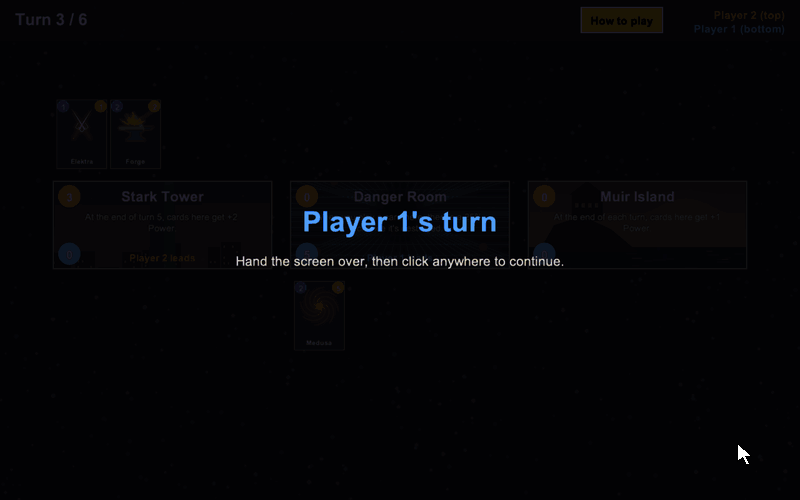
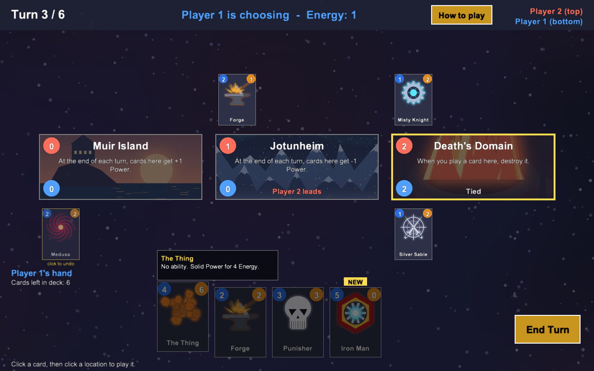
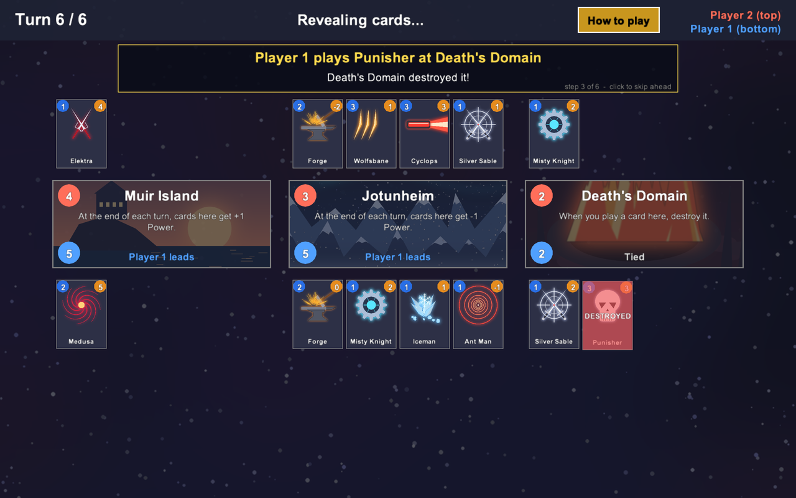
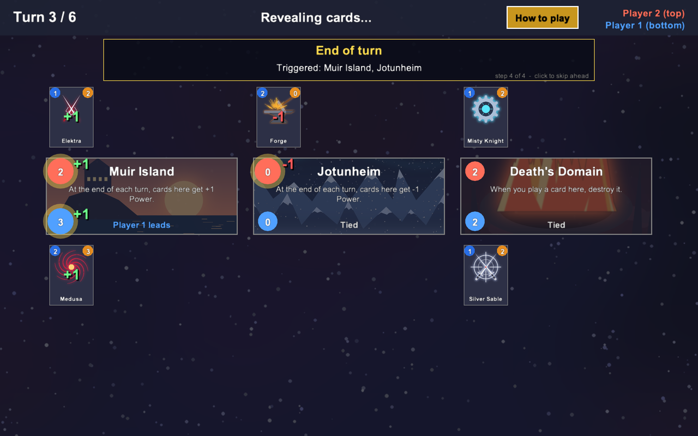
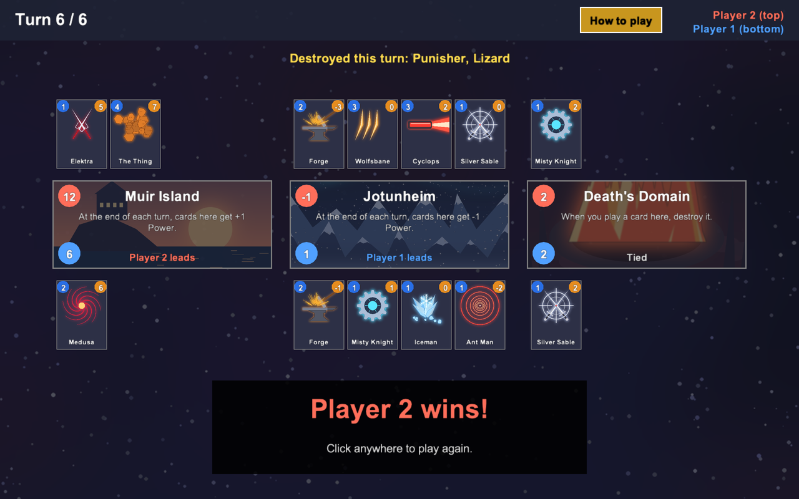

# Marvel Snap in Python

A two-player card game inspired by [Marvel Snap](https://www.marvelsnap.com/), written in Python. It has a full game engine plus a graphical interface built with the [Arcade](https://api.arcade.academy/) library.



I built this as a personal challenge: my second Python project, recreating a card game I enjoy playing. It started as a text-only game engine and grew into a full two-player game with 15 cards, 8 locations and an animated interface. The core of it is an event-driven ability system: each card and location carries its own ability, and the engine triggers four kinds of abilities at the right moments in a turn, resolving them in priority order. New cards plug in without changing the engine, and the same engine runs both the terminal and the graphical versions.

## How the game works

- The game lasts **6 turns**. Win **2 of the 3 locations** to win the game. If that's tied, whoever has more total Power wins.
- Each turn you get **Energy** equal to the turn number. Cards cost Energy and add **Power** to the location you play them at.
- Both players choose their cards in secret, then everything is revealed. The player who is winning more locations reveals first.
- One location is revealed per turn, and every location and most cards have a special ability.

Two players share one screen. The game hides each player's hand while the other one is choosing.

| Choosing cards | Revealing cards |
|---|---|
|  |  |
| **End-of-turn effects** | **Game over** |
|  |  |

## Running it

You need **Python 3.10 or newer**.

**Windows**
```
py -m venv .venv
.venv\Scripts\activate
pip install -r requirements.txt
python ui.py
```

**macOS / Linux**
```
python3 -m venv .venv
source .venv/bin/activate
pip install -r requirements.txt
python ui.py
```

There's also a text-only version that runs in the terminal: `python engine.py`.

## Content

**15 cards** with four kinds of abilities:

| Type | When it happens | Examples |
|---|---|---|
| On Reveal | Once, when the card is played | Forge, Iceman, Silver Sable, Medusa, Wolfsbane, Elektra |
| Ongoing | All the time, while the card is on the board | Iron Man, Punisher, Ant-Man, Lizard |
| End of Turn | At the end of every turn | Adam Warlock |
| None | Just Power | Misty Knight, Cyclops, The Thing, Hulk |

**8 locations**, 3 chosen at random each game: Death's Domain, Hala, Jotunheim, Muir Island, Murderworld, Asgard, Stark Tower and Danger Room.

## How the code is organized

| File | What it does |
|---|---|
| `engine.py` | The game rules: turns, energy, playing cards, turn order, power, and the winner |
| `cards.py` | The `Card` class, every card's ability, and the card list |
| `locations.py` | Every location's ability |
| `decks.py` | The two players' decks |
| `initialize_game.py` | The `Location` class, plus picking locations and shuffling decks |
| `ui.py` | The graphical interface: drawing, mouse input, and animations |

A few design decisions:

- **Abilities are functions stored as data.** Each card and location keeps a reference to its ability function plus a type (`on_reveal`, `ongoing`, `end_of_turn`, `on_play`). The engine calls each type at the right moment in the turn, so adding a card means writing one function and one line to create the card, without touching the engine.
- **Abilities are written from the owner's point of view.** Each one receives `player` and `opponent` instead of checking whether it belongs to player 1 or player 2, so the logic is only written once. Helper methods on `Location`, like `cards_of(player)`, hide how the board stores each side.
- **The engine doesn't know about the UI.** `resolve_turn` takes an optional `on_step` callback that's called after each card is played. The UI uses it to replay the turn one step at a time with captions and animations, while the text version simply doesn't pass one.

## Credits

This is a fan project for learning purposes and isn't affiliated with Marvel or Second Dinner. Marvel Snap and its characters belong to their owners. Some card and location images were generated with Python's Pillow library.
